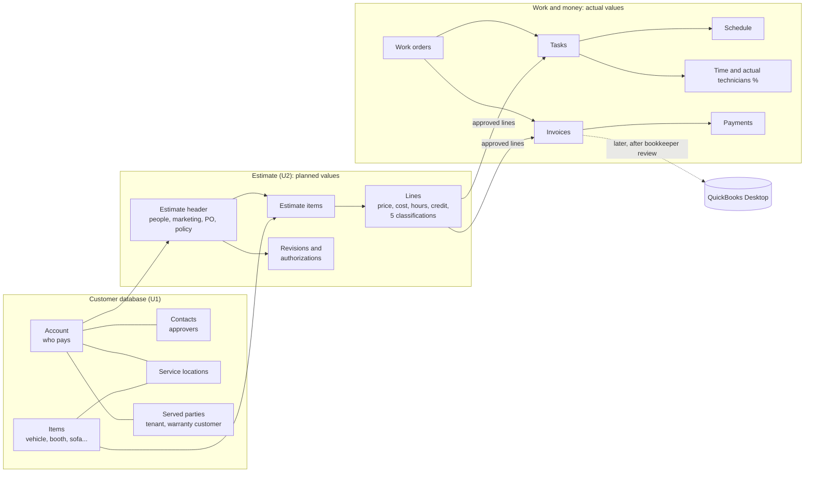

# U0: Universal Estimate Design (design only)

**Status: DRAFT for management review. Started 2026-10-21.**
- This is a design document.
- It changes **no application code, database, prices, permissions or production configuration**.
- Nothing here is built until management separately approves U1 and U2.

**Based on:**
- `docs/planning/ESTIMATING-STRATEGY.md`, including its "Decision status: final corrections" table, which takes priority
- the current CRM database as it exists on PR #5's latest commit

**Contents**
1. Overview and data flow
2. Customer database records (U1)
3. The multi-item estimate (U2)
4. The estimate line specification
5. Totals, tax and rounding rules
6. Revisions and customer authorization
7. Work orders, invoices and scheduling
8. Migration plan for existing records, and how it is proved safe
9. Phone and tablet screens (mockups)
10. Permissions and privacy
11. Placeholders reserved for later (QuickBooks, commissions, bonuses)
12. Acceptance criteria and test plan for U1 and U2
13. Open questions

---

## 1. Overview and data flow



**The rule:** estimates hold **plans** (prices, costs, hours, planned people). Work orders, time entries, costs and payments hold **actuals**. Reports compare the two, and nothing turns a plan into an actual on its own.

---

## 2. Customer database records (U1)

| Record | Key fields | Notes |
|---|---|---|
| **Account** (who pays) | account number; type (retail person, dealer, dealer group, commercial, landlord, warranty company, insurer, fleet, other); legal / company name; person name; billing address; phones; emails; SMS number; **status: normal or temporary** (walk-in with incomplete contact details); tax-exempt flag and certificate (management/accounting only, as today); credit limit; payment terms; **PO required by default**; **authorization policy** (§6); default delivery method; default invoice grouping (combined or separate); lead source; referral; segment; parent account (for dealer groups and chains) | Replaces today's `customers` as the bill-to party. Phone **or** email is required unless the status is "temporary". |
| **Contact** | account; name; title; phones; email; **can approve** (yes/no); **approval limit** ($, optional); can approve invoices; notes | Merges today's `contacts` and `fleet_authorized_contacts`. |
| **Service location** | account; name (for example "Tenant – 412 Elm St", "Lot B"); full address; access notes; on-site contact (a served party or a contact) | Every account gets at least one: its own address. |
| **Served party** | name; phones; email; address (optional); relationship (tenant, warranty-plan holder, end customer, driver) | The person whose property is repaired when they aren't the payer. |
| **Item** (repaired thing) | item type (vehicle, RV, boat, aircraft, furniture piece, booth, seating, medical/dental equipment, other); **industry type**; identifiers (VIN, HIN, N-number, serial, stock #); year/make/model/trim or manufacturer/model; description; material/fabric/color; dimensions; quantity (identical pieces, for example 120 chairs); current location; owner (account or served party); notes | Merges today's `vehicles`, `assets` and `asset_details`. A VIN must be unique among *active* vehicle items; a VIN seen on another account triggers the existing "sold vehicle" warning. |
| **Claim / authorization reference** | payer (warranty company, insurer, dealer); claim #; authorization #; authorized amount; PO / RO #; stock #; adjuster or approver; required photos; dates | Replaces today's `third_party_payers` fields on jobs, used per estimate or work order. |

**History and VIN look-up (approved D-1c):**
- Entering a VIN, HIN, N-number or serial on any estimate shows that item's **full service history**: past estimates, work orders, invoices, dates, technicians, photos, and workmanship-warranty claims.
- This helps decide whether new damage is a warranty issue on McDowells' work.
- The history is visible internally across owners. Outside users (later portals) see only their own jobs.

**Duplicates (approved D-1a):**
- Possible duplicates are flagged on screen: same phone, same email, same name with the same address, or same VIN.
- Merging needs a person's approval and is recorded in the audit history.
- Nothing is merged automatically, including during migration.

---

## 3. The multi-item estimate (U2)

**Estimate header**
- estimate number (unchanged format), revision number, status, created / valid-until dates
- **bill-to account**; **service location**; **served party** (optional); **claim / authorization reference** (optional)
- **people:** Salesperson, Estimator, Follow-up salesperson (approved)
- **marketing:** lead source, referral, campaign
- **PO required** switch (defaults from the account), PO number
- **authorization policy** in force (copied from the account; editable by management)
- planned schedule window; customer-visible notes; internal notes
- **"Show details to customer"** switches (the Phase 2.2 dent-details switch generalized)

**Estimate item** (one per vehicle, piece or group of identical pieces)
- the linked item record; item label as printed ("2022 F-150 – VIN …4567", "Booth #4", "Conference chair ×120")
- service(s) estimated; diagram marks; measurements; photos (U3); item notes
- **item subtotal**, displayed only; the estimate total is always calculated from all lines
- **planned work grouping:** which work order this item should go to (combined or separate), changeable until work starts

**Lines** belong to an item (or to the estimate as a whole, for an estimate-level fee or discount). They are specified in §4.

**Phase 2.2 PDR dents, packages and approvals** attach to the **vehicle item** they belong to. Their rules (per-dent price, overrides, packages, package approval, "show dent details") are unchanged.

---

## 4. The estimate line specification

| Group | Field | Purpose |
|---|---|---|
| Identity | line #, estimate, item, revision introduced in, option group | Where the line belongs |
| What | description (customer-facing), internal note | |
| Charge type | labor · part · material · freight-in · delivery / shipping · supply (shop-consumed) · sublet · fee · discount | Drives tax treatment (once G1 is approved) and credit |
| Quantity | quantity; unit (each, hour, panel, yard, sq ft, linear ft, seat) | |
| Price | customer unit price; line total (whole cents) | |
| **Price source** | price list and **version**; or package; or manual; for an override: who, when, why, and the suggested price | Never silent; Phase 2.2 rule kept |
| **Estimated cost** | unit cost; cost source; sublet vendor (optional) | Planned cost (actual costs live on the work order) |
| **Estimated production** | estimated labor hours; labor standard and version used | Planned hours |
| **Classification (5 fields)** | (1) service / skill type · (2) item / industry type · (3) operating department · (4) delivery method · (5) responsible team **and** planned technicians with % shares | Reporting without duplicate departments |
| **Sales attribution** | salesperson(s) with % shares (default from the header; may differ per line) | Data for commissions later |
| **Eligibility** | commission-eligible; bonus-eligible; production-credit-eligible (defaults by charge type, management-editable) | Flags only; no calculation |
| Tax | tax treatment code (today's rule kept, see §5); taxable amount; tax-exempt reason if any | Calculated by the server |
| Customer view | show / hide details; customer-visible flag per photo | |
| Option | required / optional / alternative (good / better / best); chosen or declined | Declined lines never count toward totals |
| Status | proposed · approved · declined · removed (kept in history) | Lines are never deleted after sending; they are marked removed |
| Placeholders | commission rule version, bonus rule version, QuickBooks references (§11) | Empty until approved designs exist |

**Defaults (to save keystrokes on a phone):**
- The estimating screen and the item fill the classifications. For example, a PDR line on a car becomes Paintless Dent Repair · Automobile · Auto Exterior, with the account's usual delivery method and the team that follows from it.
- The header fills the salesperson.
- Staff can change any default.

**How today's data fits:**
- Today's per-line technician shares (`estimate_labor_allocations`, in hundredths of a percent) become the line's planned technicians.
- Today's estimate-level sales team (`estimate_sales_team`) becomes every line's default sales attribution.
- Issued invoice credits (`invoice_labor_credits`, `invoice_sales_credits`) are kept exactly as they are and stay locked.

---

## 5. Totals, tax and rounding rules

1. **The server is the only calculator.** Phones and browsers display server results. Any offline draft (M2, later) shows "draft; total confirmed on sync".
2. **Whole cents** in all new tables. The existing decimal-dollar columns are kept and compared during migration (§8).
3. **Estimate total = sum of every approved or proposed (not declined, not removed) line, minus discounts, plus tax.** Item subtotals are display only.
4. **Tax per line.** The rule for each line comes from its charge type and its service. Until the accountant approves the tax decision table (ESTIMATING-STRATEGY §7), RepairPro reproduces **exactly today's results**:
   - repair labor untaxed
   - "new fabrication labor" taxed
   - parts and materials sold taxed
   - freight-in taxed
   - separately stated delivery untaxed
   - shop-consumed supplies not charged tax, with optional internal use tax
   - tax-exempt customers untaxed
5. **Discounts:**
   - Estimate-level discounts are spread across lines in proportion. Rounding pennies go to the largest line, so the total is exact.
   - Line-level discounts stay on their line.
6. **No double counting:**
   - Tax, revenue, sales credit and technician credit are counted once per line.
   - A line belongs to exactly one item and one work order.
   - Credits are split by % shares that total 100% (stored in hundredths of a percent, as today).

---

## 6. Revisions and customer authorization (approved policy)

**What needs new customer approval:**
- any **increase in the customer price**
- any **material addition or change to the scope**

**What doesn't:**
- price **decreases** (but every revision is documented)
- **internal cost** changes, when the approved scope and price are unchanged
- schedule and technician changes

**Never** change an approved price or line silently.

**How it works:**
- **Revision:** each time a sent or approved estimate changes, a new revision number is created. It records what changed (lines added, removed or re-priced), who changed it, and why. The customer can be shown "changes since your last approval".
- **Supplement:** additional damage found during the work. A supplement is a revision that adds lines, and it needs approval under the account's policy.

**Each authorization records:**
- revision #
- which lines were approved or declined
- **approver** (contact name and title)
- **method:** in person / signature (later) / phone / email reply / PO / dealer or recon manager portal (later)
- date and time
- staff member who recorded it
- PO # when applicable
- dollar amount approved

**Account authorization policy** (dealer and commercial accounts), set per account:
- who may approve, and their dollar limits
- whether a PO is required, and when (before work, or before invoicing)
- which approval methods are accepted

**PO switch** on the estimate and the work order:
- Defaults from the account.
- When it is on, the invoice can't be marked ready to send without a PO number.

**What the system blocks:**
- An approval above an approver's limit is blocked and asks for a higher approver.
- Work can't start on unapproved lines, matching today's Phase 2.2 package approval gate.

---

## 7. Work orders, invoices and scheduling

**Work orders**
- One estimate can become **one combined work order** or **several work orders** (for example one per item or per department).
- The choice is made on the estimate (each item has a planned work grouping) and can be changed by the scheduler **until work starts on the affected tasks**.
- Every work order keeps links to its estimate, revision, items and lines.

**Tasks**
- Each work order has tasks: one per item, or per item and skill.
- Each task carries:
  - its estimated hours
  - department, skill type and delivery method
  - service location
  - **planned technicians**
  - later, **actual technicians with % shares** (approved D-6)
- Actual technicians can be added or removed, with shares that total 100%. Bonuses later use actuals.

**Scheduling** (detailed in ESTIMATING-STRATEGY §7, "D-4 follow-up")
- **Tasks are scheduled, not whole work orders,** so one combined or several separate work orders look the same on the board.
- Blocks from the same estimate share a color. Tasks at the same service location are flagged to share a trip.
- Each task's hours are counted once.

**Invoices**
- Invoices can be **one combined invoice or separate invoices** per work order. The **account's default** decides (for example a dealer who wants separate invoices in one email).
- Every invoice links back to its work orders, estimate and items.
- Issued invoices stay locked, as today.

**Subject to bookkeeper review:** whether partial or progress invoices are allowed, and how the invoices map to QuickBooks Jobs.

---

## 8. Migration plan for existing records, and how it is proved safe

Migration runs inside the existing single migration path. It **adds** new tables and links, and never deletes or rewrites existing financial records.

| Today | Becomes | Rule |
|---|---|---|
| `customers` | **Account** (+ its first **service location** from its address) | Every field kept; customer number kept |
| `contacts`, `fleet_authorized_contacts` | **Contacts** | Approval flags and limits carried over |
| `fleet_accounts` | Account terms, price group and authorization policy | Discounts become price-group settings (no price changes) |
| `third_party_payers` | Accounts of type warranty / insurer / other, plus claim references | Linked to the original customer |
| `vehicles` | **Items** (vehicle / RV / boat) | VIN kept; owner = the customer |
| `assets`, `asset_details` | **Items** (furniture, booth, aircraft…) | Location, room/floor and quantity kept |
| `estimates` (one vehicle or asset) | Estimate with **one estimate item** | Same number, status, dates, totals |
| `estimate_line_items` | Lines on that item | Same amounts; classifications filled from the service and category; unknown values marked "needs review", never guessed |
| `estimate_dents`, `estimate_dent_groups`, `estimate_pricing_options` (Phase 2.2) | Attached to the vehicle item | Unchanged rules and amounts |
| `estimate_sales_team`, `estimate_labor_allocations` | Default line sales attribution; line planned technicians | Shares unchanged |
| `jobs`, `ops_cases`, `ops_tasks`, `job_planning`, `estimate_planning` | Work orders and tasks linked to the estimate item | Existing schedules and time unchanged |
| `invoices`, `invoice_line_items`, credits, `payments` | **Unchanged** (locked), linked to the new items | No amount, tax or credit is touched |
| `service_history`, `warranty_claims`, `activities` | Linked to account and item | History searchable by VIN |

**Proof that nothing changed (automated, on a copy of the demo database and the fresh-install test):**
1. For **every** estimate and invoice: subtotal, tax, discount, total, paid and balance are **identical** before and after.
2. Every line's quantity, price and total is identical. Count of lines per document is identical.
3. Sales and technician credit shares and issued credit amounts are identical.
4. Every customer's vehicles, assets, estimates, jobs, invoices, payments and history are still reachable from the new account and item.
5. The Phase 2.2 dent prices, packages and approvals still produce the same lines.
6. Possible duplicates are **reported for review**, not merged.
7. The migration can be run twice without changing anything the second time.
8. A backup is taken first, and a restore is tested (backlog DB-01).

---

## 9. Phone and tablet screens (mockups)

**Design rules for every estimating screen:**
- Built for a phone first: one column, large touch targets (at least 44 px), no sideways scrolling.
- The total and the main action stay visible at the bottom.
- Defaults fill most fields; the keyboard type matches the field (numbers, phone, email).
- Every screen is tested at phone (390 px), tablet (768 px) and desktop sizes before it is offered for approval.

### 9.1 Estimate overview (phone)
```
┌──────────────────────────────┐
│ ← EST-2026-014  Rev 2  DRAFT │
│ Boise Ford Lincoln (Dealer)  │
│ Lot B · 123 Main St, Boise   │
│ Sales: K. Smith  Est: J. Lee │
│ PO required ● PO# ________   │
├──────────────────────────────┤
│ ITEMS (3)                    │
│ ┌──────────────────────────┐ │
│ │ 🚗 2022 F-150 …4567       │ │
│ │ PDR · 6 dents   $   845  │ │
│ └──────────────────────────┘ │
│ ┌──────────────────────────┐ │
│ │ 🚗 2021 Explorer …9912    │ │
│ │ Interior · 2     $  310  │ │
│ └──────────────────────────┘ │
│ ┌──────────────────────────┐ │
│ │ 🚗 2023 Edge …0031        │ │
│ │ Pricing incomplete  ⚠    │ │
│ └──────────────────────────┘ │
│ [ + Add item ]               │
├──────────────────────────────┤
│ Total $1,155 + tax  [Review] │
└──────────────────────────────┘
```

### 9.2 Add item (phone)
```
┌──────────────────────────────┐
│ Add item                     │
│ [ Scan VIN ] [ Type VIN ]    │
│ ─ or pick ─                  │
│ ( ) Vehicle  ( ) Furniture   │
│ ( ) Booth/seating ( ) Boat   │
│ ( ) Aircraft ( ) Equipment   │
│ Previous history found:      │
│  ⚠ 2 jobs on this VIN (2025) │
│    [ View history ]          │
│ Service: [ PDR           ▼ ] │
│ [ Add item ]                 │
└──────────────────────────────┘
```

### 9.3 Item detail (phone): diagram, lines, photos
```
┌──────────────────────────────┐
│ ← 2022 F-150 …4567           │
│ [Diagram] [Lines] [Photos 4] │
│ ┌──────────────────────────┐ │
│ │   (vehicle diagram;       │ │
│ │    tap a panel)           │ │
│ └──────────────────────────┘ │
│ Hood · 3 dents · $360        │
│ Roof rail L · glue pull $180 │
│ R&I headliner        $120    │
│ Item subtotal        $845    │
│ Dept: Auto Exterior · Dealer │
│ Route · Tech: (planned) M.S. │
├──────────────────────────────┤
│ [ Save ]       [ Next item ] │
└──────────────────────────────┘
```

### 9.4 Review and approval (phone)
```
┌──────────────────────────────┐
│ Review · Rev 2               │
│ Changes since Rev 1:         │
│  + Roof rail L     +$180  ⬆  │
│  − Door ding        −$45     │
│ Needs customer approval ⬆    │
│ Approver: [ T. Grant ▼ ]     │
│   limit $2,000 ✓             │
│ Method: (•)Phone ( )PO ( )In │
│ Recorded by: J. Lee          │
│ [ Record approval ]          │
│ [ Show customer view ]       │
└──────────────────────────────┘
```

### 9.5 Tablet layout
Two panes:
- **Left:** the item list, with the estimate total at the bottom.
- **Right:** the selected item's diagram, lines and photos side by side.

The same controls as on a phone, with no hidden features.

*Clickable mockups can be produced in a later revision of this PR if management prefers them to these wireframes.*

---

## 10. Permissions and privacy

- **Enforced on the server, as today.** Hiding a button is never the only protection.
- **Tax-exempt status, credit limits and authorization policies:** management and accounting only (extends today's rule).
- **Internal costs, cost sources, margins and eligibility flags:** never shown to customers. Staff without cost permission can't see them, as today.
- **Served parties:** a paying account (landlord, warranty company) may see the served party's details and photos for **its own jobs only** (approved D-1b).
- **Item history across owners:** internal only. Future portals show only the viewer's own jobs.
- **Every change** to accounts, contacts, authorization policies, approvals, prices and shares is recorded in the existing audit history.

---

## 11. Placeholders reserved for later (no logic built)

| Placeholder | Where | Why |
|---|---|---|
| QuickBooks reference IDs (customer/job/item/class/sales rep/invoice) | Account, work order, line, invoice | So a later, bookkeeper-approved export can link records without redesign. Current practice (technician = Class, work order = Job, Sales Rep = commissions; **QuickBooks Desktop Enterprise 24.0, office computer**) is **business information to validate**, not a design rule. |
| QuickBooks export mapping (grouping of classifications) | Settings, later | Group or separate service, industry, department, delivery method and team when exporting. |
| Split-credit export method | Settings, later | Decided with the bookkeeper. Shares are stored internally from the start. |
| Commission rule version, bonus rule version | Line | Filled once management approves the rules. |
| Customer signature | Authorization record | M3, later. |
| Portal user | Authorization record | DP1, later. |

---

## 12. Acceptance criteria and test plan for U1 and U2

**Automated (CI):**
- The migration proof in §8: every total, tax, credit and history link identical, before and after, on the demo database and a fresh install.
- Tax per line reproduces today's results for every existing estimate and invoice.
- Multi-item estimates:
  - totals equal the sum of lines
  - declined and removed lines are excluded
  - discounts are exact to the cent
  - no line counted twice
  - shares total 100%
- Authorization:
  - a price increase or new line requires approval
  - a decrease records a revision without approval
  - an internal cost change needs nothing
  - an approval above the approver's limit is refused
  - the PO switch blocks "ready to send" without a PO number
- Duplicate detection flags without merging. VIN look-up returns the prior history.
- Permissions:
  - internal costs are hidden from customer views and from roles without cost permission
  - a paying account's view shows only its own jobs (tested at the server level)
- All existing suites still pass: verify, fresh install, security, estimating, pricing, calculation, release integrity, and the Phase 2.1 and 2.2 browser checks.

**Browser (desktop 1366 px, tablet 768 px, phone 390 px):**
- Create an estimate with three items (two vehicles and one booth), add lines to each, and check the totals.
- Edit a price upward, then record a phone approval with an approver and limit.
- Split the estimate into two work orders, then combine them again.
- Reopen everything after signing out and in: everything is still there.
- No sideways scrolling, no page errors, and plain-English messages when the connection drops.

**Owner Codespaces checklist (written with each PR):**
- Open an existing estimate: it looks and totals exactly as before.
- Create a multi-item dealer estimate on a phone.
- Look up a VIN with history.
- Record an approval.
- Toggle the PO switch.
- Split and combine work orders.
- Print the customer copy, grouped by item.

---

## 13. Open questions (with recommendations)

| # | Question | Recommendation | Needed before |
|---|---|---|---|
| Q1 | Value lists for skill type and item/industry type (ESTIMATING-STRATEGY §7 "Classifications") | Approve the proposed lists; edit later in settings | U2 |
| Q2 | Default mapping of each service to department, team and skill | Approve the draft (Auto Exterior: PDR, hail, R&I; Auto Interior: interior repair; Auto Cosmetic Shop: tint, PPF, ceramic, polish, headlights, touch-up, detailing; Upholstery: all upholstery; Furniture Repair: furniture repair, warranty furniture, handyman) | U2 |
| Q3 | Partial or progress invoices for separate work orders | Bookkeeper to decide; design allows either | Invoice PR |
| Q4 | Who may split or combine work orders | Scheduler and management, until work starts | U2 |
| Q5 | Which approval methods are allowed by default for retail customers | In person, phone and email reply | U2 |
| Q6 | Wireframes vs clickable mockups for this review | Wireframes now; clickable mockups if wanted | U0 approval |
| Q7 | Tax decision table (18 situations) | Accountant to approve; today's tax unchanged until then | G1 |
